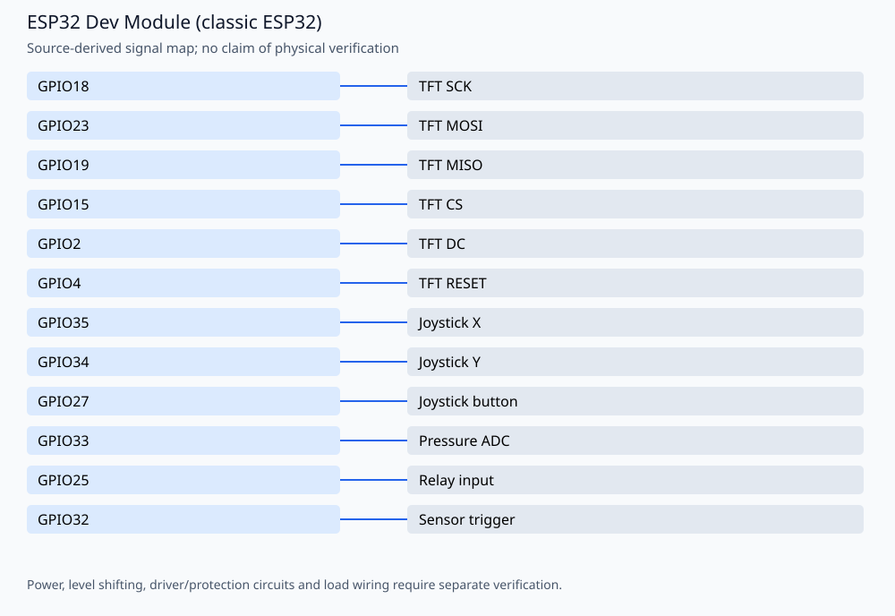

# Automatic Cat6 cable straightener — ESP32 control prototype

An ILI9341/joystick interface with sensor, joystick, timed automatic and pressure-display modes. Author: **Amir Mobasheraghdam**. The firmware is an actuator-control prototype, not a certified pressure or safety controller.

## Reproducible build

Install Python 3 and **Arduino CLI 1.3.1**, then run from this repository:

```bash
python3 tools/check_firmware.py --install
```

The helper installs `esp32:esp32@2.0.17` and `Adafruit BusIO@1.17.0`, `Adafruit GFX Library@1.12.1`, `Adafruit ILI9341@1.6.2`. It compiles these alternatives
separately in temporary folders, without uploading or rewriting the originals:

- `Cat6-Netzwerkkabelglätter.cpp`

Build target: `esp32:esp32:esp32`. Once dependencies are installed, omit `--install`
to build offline. `--jobs 2` is the default. Set `ARDUINO_CLI` to a CLI executable
or wrapper when using a custom Arduino configuration. Exact build inputs are in
[`tools/firmware.json`](tools/firmware.json). Library dependencies are listed
explicitly and installed with `--no-deps` so transitive updates cannot silently
replace the pinned versions. These are tested build versions, not a claim that
all other core/library versions are incompatible.

The GitHub Actions workflow repeats the firmware checks on pushes and pull
requests. Compilation validates software/toolchain compatibility; it does not
establish hardware safety or successful physical operation.

## Signal assignments



| Signal | Board pin |
| --- | --- |
| TFT SCK | GPIO18 |
| TFT MOSI | GPIO23 |
| TFT MISO | GPIO19 |
| TFT CS | GPIO15 |
| TFT DC | GPIO2 |
| TFT RESET | GPIO4 |
| Joystick X | GPIO35 |
| Joystick Y | GPIO34 |
| Joystick button | GPIO27 |
| Pressure ADC | GPIO33 |
| Relay input | GPIO25 |
| Sensor trigger | GPIO32 |

## Operation and validation limits

These are the constants in `Cat6-Netzwerkkabelglätter.cpp`. The relay is active LOW. The source already uses debounced button transitions, a triple-click exit and wrap-safe timing; no relay sequence, calibration or timing is changed by this maintenance update. The sensor curve assumed by the code is 0.5–4.5 V for 0–700 kPa, with `DIVIDER_RATIO = 20/30`. Those assumptions must be checked against the actual transducer.

The former README drawing incorrectly tied the ADC divider to the 5 V supply. For the **assumed** 10 kΩ/20 kΩ divider, the intended topology is **sensor output → 10 kΩ → ADC node → 20 kΩ → GND**; GPIO33 measures the ADC node. Thus 4.5 V at the sensor output gives 3.0 V at the node. This arithmetic does not validate sensor faults, tolerance, grounding or electrical protection. The signal diagram deliberately omits an unverified power/protection design. Hardware review is required before using the corrected wiring guidance.

To build in Arduino IDE, use an empty matching `.ino` wrapper and keep this source as `.cpp`; the supplied helper does that automatically. Check `MAX_PRESSURE_KPA`, `DIVIDER_RATIO`, `TFT_CS`, relay polarity and the actual source before any upload. Startup calibration requires the joystick centered and a known zero-pressure condition. Test with the actuator/load disconnected first. No hardware behavior has been validated in the cloud.

No physical testing, new hardware photographs or measured electrical/optical
performance is claimed. Retain the author attribution and existing license/source
notices when reusing the project.

## License

The original project documentation publishes this project under the **MIT License**. Retain the existing source notices.
